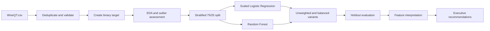

# Wine Quality Prediction: Classification & Model Interpretation

**Applied Machine Learning Study · Python · scikit-learn · Imbalanced Classification**

An applied machine learning study with an end-to-end notebook workflow for predicting high-quality wines from physicochemical measurements: data cleaning, exploratory analysis, stratified splitting, preprocessing, model training, class weighting, evaluation, and interpretation. An executive report and recorded presentation connect the technical work to production quality screening.

**Four model configurations, 11 predictors, and five evaluation metrics.** Balanced Logistic Regression detects more high-quality wines; balanced Random Forest delivers more precise positive predictions. The project explains that trade-off through metrics and confusion matrices.

[Executive report](docs/wine-quality-executive-report.pdf) · [Video presentation](https://youtu.be/zjw72T-T930) · [Analysis notebook](notebooks/analise_wine_quality.ipynb) · [Metrics CSV](results/metricas_modelos.csv)


## Problem and intended use

Can laboratory measurements help identify wines likely to receive a high quality score?

| Target class | Rule | Meaning |
|---|---|---|
| `1` | `quality >= 7` | High quality |
| `0` | `quality < 7` | Low or medium quality |

The proposed application is **batch screening and decision support**, complementing expert sensory evaluation. This repository demonstrates an offline modeling study; deployment and measured production outcomes are outside its implemented scope.

## Skills demonstrated

| Competency | Evidence |
|---|---|
| Python data preparation | pandas and NumPy for duplicate handling, target creation, and feature selection |
| Exploratory data analysis | Summary statistics, class distributions, correlations, histograms, boxplots, and IQR checks |
| Preprocessing and leakage control | Excluding labels and IDs from predictors; fitting scaling inside the training pipeline |
| Supervised learning | Logistic Regression and a 150-tree Random Forest |
| Imbalanced classification | Stratified sampling and comparison of unweighted and class-weighted models |
| Model evaluation | Accuracy, precision, recall, F1, ROC-AUC, classification reports, and confusion matrices |
| Model interpretation | Tree feature importance and standardized regression coefficient magnitudes |
| Executive communication | A 15-page report, comparative charts, and recorded presentation |

## End-to-end workflow



### 1. Prepare the dataset

Input: [data/WineQT.csv](data/WineQT.csv), identified in the project report as a public Wine Quality dataset.

| Checkpoint | Records |
|---|---:|
| Original dataset | 1,143 |
| Duplicates removed, ignoring `Id` | 125 |
| Cleaned dataset | 1,018 |
| High-quality wines | 137 (13.46%) |
| Low/medium-quality wines | 881 (86.54%) |

Duplicate detection considers all original columns except `Id`: different identifiers do not make otherwise identical observations unique. No missing values were found in the modeling columns.

The 11 predictors are fixed acidity, volatile acidity, citric acid, residual sugar, chlorides, free sulfur dioxide, total sulfur dioxide, density, pH, sulphates, and alcohol. The notebook excludes `Id`, `quality`, and `quality_binary` from the feature matrix.

### 2. Explore distributions, relationships, and outliers

The analysis examines original scores, class imbalance, correlations, predictor histograms, and boxplots. The IQR summary counts observations outside `Q1 - 1.5 × IQR` and `Q3 + 1.5 × IQR`.

Flagged values are retained as potentially legitimate composition differences rather than automatically discarded. Standardization makes predictor scales comparable for Logistic Regression; it does not remove outliers.

The final feature set uses the 11 original measurements. Derived features were considered in the report but were not included in the implementation.


### 3. Split and preprocess

- **Training:** 763 wines (75%), including 103 high-quality examples.
- **Testing:** 255 wines (25%), including 34 high-quality examples.
- **Stratification:** preserves target-class proportions.
- **Random seed:** `42` for the split and estimators.
- **Scaling:** `StandardScaler` is fitted inside a scikit-learn `Pipeline` using training data only.

Deduplication precedes splitting to reduce the risk of identical observations appearing in both sets.

### 4. Train four configurations

| Configuration | Implementation | Purpose |
|---|---|---|
| Logistic Regression | `StandardScaler` + `LogisticRegression(max_iter=1000)` | Interpretable linear baseline |
| Balanced Logistic Regression | Same pipeline with `class_weight='balanced'` | Increase penalties for minority-class errors |
| Random Forest | `RandomForestClassifier(n_estimators=150)` | Capture nonlinear relationships and interactions |
| Balanced Random Forest | Same forest with `class_weight='balanced'` | Compare class weighting in a tree ensemble |

Balancing changes **training class weights**. It does not resample the test set or generate synthetic observations.

## Results: choose the model for the decision

The table reproduces the committed [metrics CSV](results/metricas_modelos.csv), rounded to four decimals. Precision, recall, and F1 refer to high-quality wines; ROC-AUC uses predicted probabilities.

| Model | Class weighting | Accuracy | Precision | Recall | F1 | ROC-AUC |
|---|---|---:|---:|---:|---:|---:|
| Logistic Regression | Balanced | 0.8157 | 0.4085 | **0.8529** | **0.5524** | 0.8958 |
| Logistic Regression | None | 0.8902 | 0.6500 | 0.3824 | 0.4815 | 0.8998 |
| Random Forest | None | 0.8980 | 0.7500 | 0.3529 | 0.4800 | 0.9095 |
| Random Forest | Balanced | **0.9020** | **0.8462** | 0.3235 | 0.4681 | **0.9228** |

Predicting every test wine as low/medium quality would already achieve **86.67% accuracy** (221 out of 255). Accuracy alone can therefore conceal weak detection of high-quality wines.

| Decision priority | Configuration favored by this holdout | Observed behavior |
|---|---|---|
| Find more potentially high-quality wines | Balanced Logistic Regression | Finds 29 of 34 positives, with 42 false positives |
| Reduce incorrect high-quality selections | Balanced Random Forest | Finds 11 of 34 positives, with only 2 false positives |

The original executive report favors Random Forest overall. The exported results make the selection criterion more precise: **balanced Random Forest leads in accuracy, precision, and ROC-AUC; balanced Logistic Regression leads in recall and F1**. A higher ROC-AUC does not guarantee higher recall at the default decision threshold.

## Interpreting the models

The notebook compares balanced Random Forest feature importances with absolute balanced Logistic Regression coefficients. Because the regression inputs are standardized, coefficient magnitudes can be compared within that model.


Alcohol and sulphates stand out in both models, with volatile acidity also among the leading factors. The comparison chart divides each model's importance values by its own maximum. It shows relative prominence within a model rather than a common absolute scale across models.

These are predictive associations. Feature importance does not establish that changing a chemical property will cause a particular improvement in perceived wine quality.

## Visual deliverables

The [results directory](results/) contains chart exports and the model metrics table.

| Analytical stage | Evidence |
|---|---|
| Target distribution | [Quality scores](results/distribuicao_qualidade.png), [class counts](results/balanceamento_classes.png), [class proportions](results/pizza_classes_qualidade.png) |
| Predictor exploration | [Correlations](results/matriz_correlacao.png), [histograms](results/distribuicao_variaveis.png), [outlier boxplots](results/boxplots_outliers.png) |
| Training sample | [Training class distribution](results/balanceamento_treino.png) |
| Unweighted errors | [Logistic Regression](results/matriz_confusao_logistic_regression.png), [Random Forest](results/matriz_confusao_random_forest.png) |
| Weighted errors | [Balanced Logistic Regression](results/matriz_confusao_logistic_regression_balanceada.png), [balanced Random Forest](results/matriz_confusao_random_forest_balanceada.png) |
| Model comparison | [Metric chart](results/comparacao_metricas_modelos.png), [metrics CSV](results/metricas_modelos.csv) |
| Interpretation | [Forest importance](results/importancia_variaveis.png), [regression importance](results/importancia_variaveis_logistic_regression.png), [relative comparison](results/principais_fatores_comparativo.png) |

Chart labels are in Portuguese.

## Executive report and presentation

The [15-page executive report](docs/wine-quality-executive-report.pdf) presents the objective, cleaning decisions, EDA, outlier policy, preprocessing, models, results, feature interpretation, and implications for production. The [recorded presentation](https://youtu.be/zjw72T-T930) accompanies the written analysis. Both are in Portuguese.

The proposed application is to screen batches, prioritize expert review, and monitor measurements associated with high-quality predictions. An operational system would need validation on new batches and a threshold selected against the real costs of missed selections and false positives.

## Reproduce the analysis

From the repository root:

```bash
python -m venv .venv
```

Activate with `.venv\Scripts\Activate.ps1` in PowerShell or `source .venv/bin/activate` on macOS/Linux, then run:

```bash
python -m pip install -r requirements.txt
python -m notebook notebooks/analise_wine_quality.ipynb
```

Execute all cells in order. The notebook locates the dataset from the root or `notebooks/` directory and writes outputs to `results/`. Rerunning it replaces the corresponding charts and metrics.

## Scope and limitations

- Evaluation uses one stratified holdout with 34 positive test examples. Cross-validation, hyperparameter search, and external validation are not implemented.
- Class weights are compared at default prediction thresholds. Threshold optimization and probability calibration remain outside the implemented study.
- Models are fitted and interpreted in the notebook; a serialized model and an inference API are not delivered.
- Dependencies are not version-pinned, so library changes can affect reproducibility.

## Repository guide

```text
data/WineQT.csv                      Input data
notebooks/analise_wine_quality.ipynb  Complete analytical and modeling workflow
results/                             Exported charts and model metrics
docs/wine-quality-executive-report.pdf
presentation/                        Original reserved presentation directory
requirements.txt                     Python dependencies
README.md                            Project narrative and execution guide
```

## Related studies

These collaborative studies explore complementary problems in business analytics, machine learning, and data engineering.

| Study | Focus | Repository |
|---|---|---|
| Olist seller performance | Marketplace analytics, customer satisfaction, and executive recommendations | [Explore the study](https://github.com/joaomottin/olist-seller-performance-analysis) |
| Wine quality prediction | Supervised learning, imbalanced classification, and model interpretation | [Explore the study](https://github.com/joaomottin/wine-quality-machine-learning) |
| Brazil data market intelligence | AWS architecture, distributed data preparation, and analytical reporting | [Explore the study](https://github.com/joaomottin/brazil-data-market-aws-pipeline) |

## Collaborators

Developed collaboratively as part of the FIAP postgraduate program.

- Felipe Macedo da Silva
- João Pedro Mezzadri Mottin
- Miguel Fernandes Martins de Bastos
- Thanael Butewicz
- Verônica de Fátima Machado Silva
